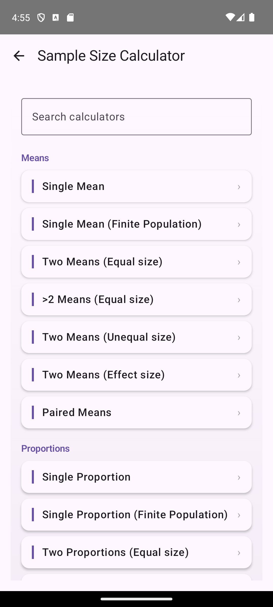
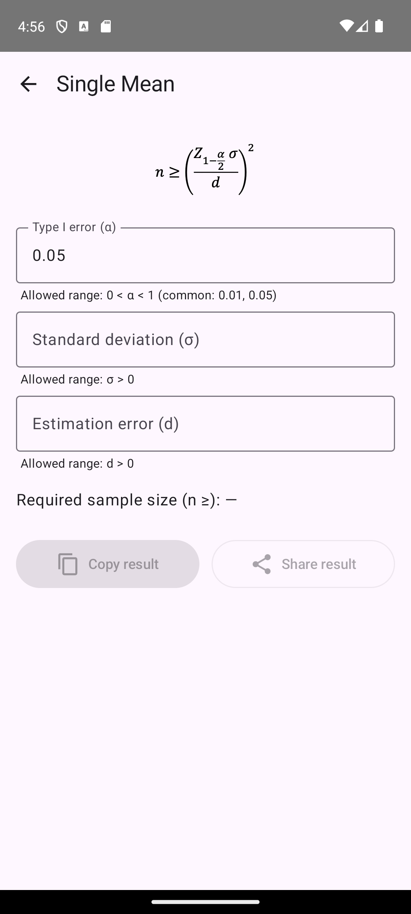
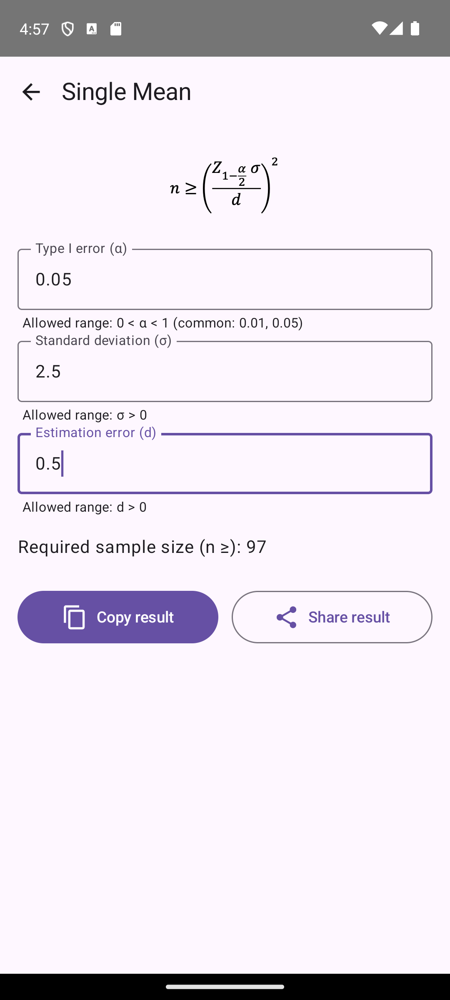

<div align="center">

# BioCalX
### Clinical Sample Size Calculator for Android

[](https://android.com)
[](https://android-arsenal.com/api?level=24)
[](https://kotlinlang.org)
[](https://developer.android.com/jetpack/compose)
[](LICENSE)
[](https://github.com/AliiReezaa/BioCalX/releases)

**BioCalX** is a free, offline Android application that provides 20 validated statistical sample size calculators for medical and epidemiological research. Designed for clinicians, researchers, and students.

[Download APK](#installation) · [Report Bug](https://github.com/AliiReezaa/BioCalX/issues/new?template=bug_report.yml) · [Request Feature](https://github.com/AliiReezaa/BioCalX/issues/new?template=feature_request.yml)

</div>

---

## Features

- **20 sample size calculators** covering the full range of common study designs
- **Formula images** displayed alongside each calculator for reference
- **Live validation** — inputs are validated in real-time with range hints
- **Copy & Share** — export results as formatted text in one tap
- **PDF export** — generate a report including all inputs and results
- **APA & Vancouver citations** — auto-generated citations ready to paste into a manuscript
- **Calculation history** — results saved locally via Room database
- **Fully offline** — no internet connection required
- **Material 3 design** with splash screen and smooth navigation

---

## Calculators

<details>
<summary><strong>Means (7 calculators)</strong></summary>

| # | Calculator | Formula |
|---|-----------|---------|
| 1 | Single Mean | n ≥ (Z·σ/d)² |
| 2 | Single Mean — Finite Population | Finite population correction |
| 3 | Two Means — Equal groups | n = 2(Zα+Zβ)²σ²/δ² |
| 4 | Two Means — Unequal groups | With allocation ratio r |
| 5 | Two Means — Effect size | Cohen's d |
| 6 | More Than Two Means (ANOVA) | Per-group n |
| 7 | Paired Means | n = (Zα+Zβ)²σd²/δ² |

</details>

<details>
<summary><strong>Proportions (6 calculators)</strong></summary>

| # | Calculator | Formula |
|---|-----------|---------|
| 8 | Single Proportion | n ≥ Z²p(1−p)/d² |
| 9 | Single Proportion — Finite Population | Finite population correction |
| 10 | Two Proportions — Equal groups | Two-sample z-test |
| 11 | Two Proportions — Unequal groups | With allocation ratio |
| 12 | More Than Two Proportions | Chi-square (k groups) |
| 13 | Paired Proportions (McNemar) | Discordant pairs |

</details>

<details>
<summary><strong>Correlation & Diagnostic (4 calculators)</strong></summary>

| # | Calculator | Method |
|---|-----------|--------|
| 14 | Correlation Coefficient | Fisher's Z transformation |
| 15 | Estimate Sensitivity | Normal approximation |
| 16 | Estimate Specificity | Normal approximation |
| 17 | Area Under ROC Curve | Hanley & McNeil |

</details>

<details>
<summary><strong>Study Designs (3 calculators)</strong></summary>

| # | Calculator | Method |
|---|-----------|--------|
| 18 | Case–Control Study | Kelsey formula |
| 19 | Cohort Study | Relative risk |
| 20 | Survival Study (Time-to-event) | Freedman formula |

</details>

---

## Screenshots

<div align="center">

| Splash | Main Menu | Calculator | Result |
|--------|-----------|------------|--------|
|  |  |  |  |

</div>

---

## Installation

### Option 1 — Install APK directly

1. Download the latest APK from [Releases](https://github.com/AliiReezaa/BioCalX/releases)
2. On your Android device, enable **Install from unknown sources**  
   (Settings → Security → Install unknown apps)
3. Open the downloaded APK and tap **Install**

**Minimum requirement:** Android 7.0 (API 24) or higher

### Option 2 — Build from source

See [Building from Source](#building-from-source) below.

---

## Building from Source

### Prerequisites

- [Android Studio](https://developer.android.com/studio) Hedgehog (2023.1.1) or newer
- Android SDK with API 34 installed
- JDK 17

### Steps

```bash
# 1. Clone the repository
git clone https://github.com/AliiReezaa/BioCalX.git
cd BioCalX

# 2. Open in Android Studio
# File → Open → select the cloned folder

# 3. Let Gradle sync complete, then build
./gradlew assembleDebug

# The APK will be at:
# app/build/outputs/apk/debug/app-debug.apk
```

Or press **Run ▶** in Android Studio to build and deploy directly to a device/emulator.

---

## Architecture

BioCalX follows a clean **layered architecture**:

```
┌─────────────────────────────────────┐
│           UI Layer                  │
│  Jetpack Compose screens &          │
│  reusable components                │
├─────────────────────────────────────┤
│         Domain Layer                │
│  Pure Kotlin formula use cases,     │
│  models, repository interfaces      │
├─────────────────────────────────────┤
│          Data Layer                 │
│  Room database, DAOs, entities      │
└─────────────────────────────────────┘
```

Navigation is handled by a custom sealed class (`AppScreen`) without any external navigation library. State is managed directly in Composable functions using `remember`/`mutableStateOf`.

For a full breakdown see [`Architecture/architecture.md`](Architecture/architecture.md) *(in the release package)*.

---

## Tech Stack

| Technology | Purpose |
|-----------|---------|
| [Kotlin](https://kotlinlang.org) | 100% Kotlin codebase |
| [Jetpack Compose](https://developer.android.com/jetpack/compose) | Declarative UI |
| [Material 3](https://m3.material.io) | Design system & theming |
| [Room](https://developer.android.com/training/data-storage/room) | Local SQLite persistence |
| [Kotlin Coroutines & Flow](https://kotlinlang.org/docs/coroutines-overview.html) | Async database operations |
| [Splash Screen API](https://developer.android.com/develop/ui/views/launch/splash-screen) | Android 12+ splash screen |
| [FileProvider](https://developer.android.com/reference/androidx/core/content/FileProvider) | Secure PDF file sharing |

---

## Project Structure

```
app/src/main/java/com/example/samplesizecalculator/
├── MainActivity.kt              Entry point
├── SampleSizeApp.kt             Root composable & navigation
├── ui/
│   ├── screens/                 20 calculator screens + splash + menu
│   ├── components/              Reusable UI components
│   ├── theme/                   Color, typography, Material 3 theme
│   ├── navigation/              AppScreen sealed class
│   └── utils/                   PDF, clipboard, share, citation helpers
├── domain/
│   ├── models/                  CalculatorId enum, data models
│   ├── repositories/            Repository interfaces
│   └── usecases/                Statistical formula implementations
└── data/
    ├── local/                   Room database, DAO, entities
    └── repositories/            Repository implementations
```

---

## Contributing

Contributions, bug reports, and feature suggestions are welcome.

1. Fork the repository
2. Create a feature branch: `git checkout -b feature/your-feature`
3. Commit your changes: `git commit -m "Add your feature"`
4. Push to your branch: `git push origin feature/your-feature`
5. Open a Pull Request

Please use the provided issue templates for bug reports and feature requests.

---

## License

This project is licensed under the **MIT License** — see the [LICENSE](LICENSE) file for details.

---

## Acknowledgements

- Statistical formulas based on standard biostatistics references
- Developed at **Babol University of Medical Sciences**
- [Acklam's algorithm](https://web.archive.org/web/20151030215612/http://home.online.no/~pjacklam/notes/invnorm/) for the inverse standard normal CDF

---

<div align="center">
Made with ❤️ for medical researchers
</div>

---

## Authors

- **Ali Reza Soleymani Taloubaghi**: design, implementation and testing ([website](https://aliireezaa.github.io))
- **Dr. Danial Habibi** (Babol University of Medical Sciences): statistical methodology and formula validation

Developed with Babol University of Medical Sciences for clinical and epidemiological researchers.
